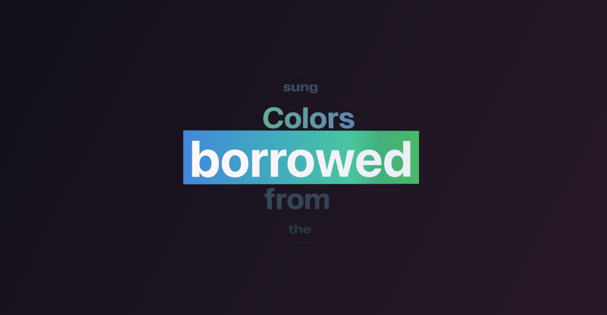
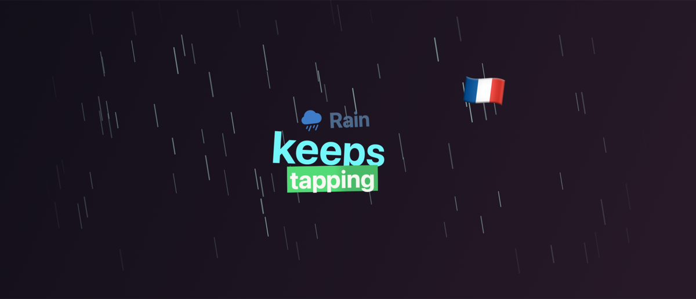
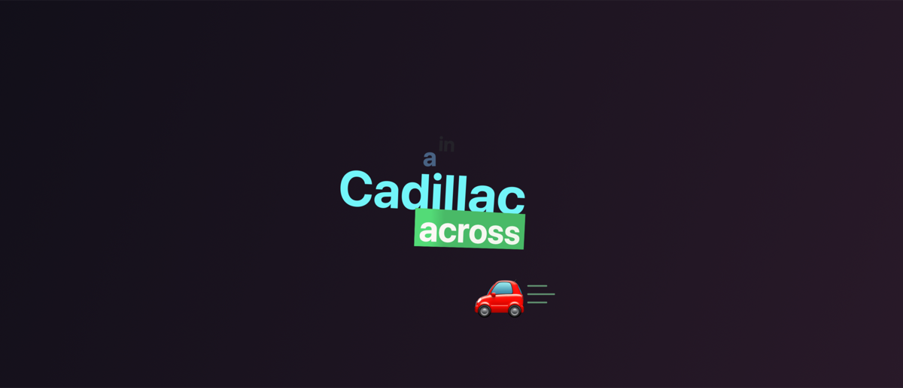
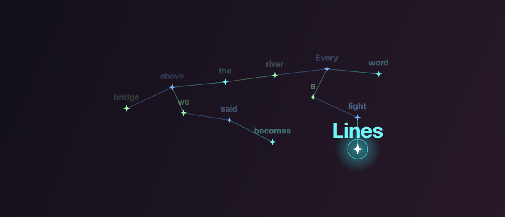
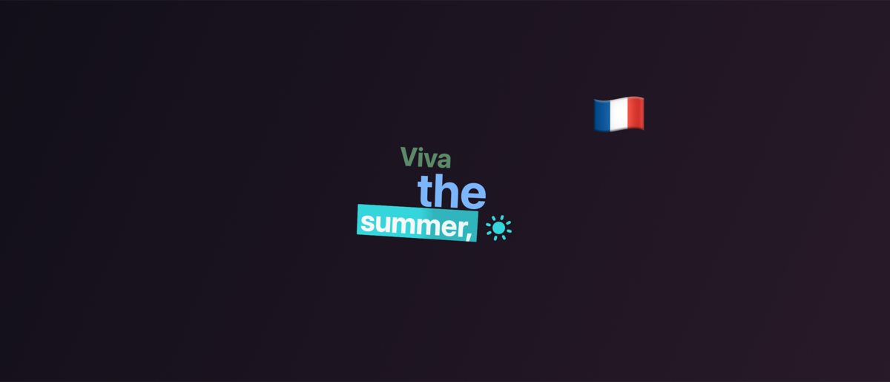
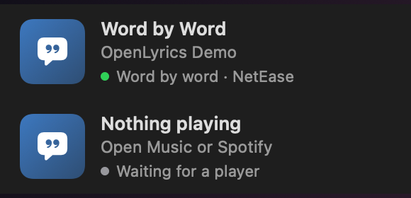

<div align="center">

# OpenLyrics

**Word-by-word lyrics that move with your music — on your Mac's lock screen and desktop.**

For Apple Music and Spotify. Kinetic typography in your album's colors, with icons for the words
that have one. Free, open, no account.

[](https://github.com/Ayanprakash35/OpenLyrics/releases/latest)


[](LICENSE)

### [⬇ Download OpenLyrics](https://github.com/Ayanprakash35/OpenLyrics/releases/latest/download/OpenLyrics.dmg)

<!-- DEMO VIDEO: on github.com, edit this file and drag the .mp4 right here — GitHub uploads it and
     inserts a player link. See docs/media/README.md for the recordings planned. -->


</div>

---

## Contents

- [What it does](#what-it-does)
- [Styles](#styles)
- [Colors](#colors)
- [Effects and easter eggs](#effects-and-easter-eggs)
- [Install](#install)
- [Using OpenLyrics](#using-openlyrics)
- [Troubleshooting](#troubleshooting)
- [How it works](#how-it-works)
- [Privacy](#privacy)
- [Building from source](#building-from-source)
- [Credits](#credits)

## What it does

OpenLyrics sits in your menu bar and watches what Apple Music or Spotify is playing. It finds the
song's time-synced lyrics and sets them in motion one word at a time: the word being sung lands in
a highlight box that fills as it's sung, the words before it rise, shrink and fade, and everyday
words — *you, love, call, rain, fire, night, angels, pizza…* — get a little animated icon. The
colors come from the album cover, and everything bounces gently on the beat.

It's at its best on the **lock screen**: lock your Mac with music playing and the lyrics keep going
over your wallpaper, with the display kept awake until the song's done.

- **Three styles** — Stack, Lens and Lines.
- **Over 1,400 icon words** — SF Symbols in the album's colors, plus emoji where no symbol fits.
- **Colors from the cover** — every word its own color, or blended gradients; or pick your own.
- **Bounces to the beat** — from the singing's timing, or from your Mac's sound output.
- **Effects and easter eggs** — rain when it rains, a car driving by when one's sung about, the
  lyrics branching into a constellation at a bridge, and surprises for particular songs.
- **Many languages** — Hindi, Spanish, Korean, Japanese, Chinese and more, with icon words in
  those languages (romanized Hindi and Devanagari included).
- **Fast, accurate lyrics** — word-timed where available, cached for offline replays.
- **Out of the way** — click-through, on every Space, alongside full-screen apps, hidden while
  paused, nothing in the Dock.

<!-- SCREENSHOTS: add lock-screen photos here, one per song, e.g.
     -lockscreen.png" width="360"> -->

## Styles

| Stack | Lens | Lines |
| :---: | :---: | :---: |
|  |  | *one line at a time* |
| Words pile into a wall that drifts in 3D. The sung word sits in its box at the bottom; when the next word starts, the wall springs up a row. | The song's words on a curved column under a lens. The word being sung rolls to the middle, closest to the glass. | The classic look: a line fills word by word, with the next line underneath. |

<!-- STYLE VIDEOS: a short clip of each style, e.g. docs/media/stack.mp4, lens.mp4, lines.mp4 -->

## Colors

With **Auto Sync with Album** on, OpenLyrics reads up to four distinct colors from the cover art:
a green and blue cover gives green and blue lyrics. Two ways to use them:

| Each Word Its Own Color (default) | Blend Colors Within Words |
| :---: | :---: |
|  |  |
| Every word's box, text and icon takes the next of the cover's colors. | Every word blends the same gradients: text from one cover color to another, the box from a third. |

Or turn Auto Sync off and pick the **Lyric Text**, **Highlight** and **Secondary Text** colors
yourself.

## Effects and easter eggs

Some words set something off around the lyrics:

| Rain, snow, fire… | Cars and other vehicles |
| :---: | :---: |
|  |  |
| *rain, storm, snow, fire, stars, hearts, money, party, thunder* — in several languages | *car, truck, train, plane, boat…* and makes and models: a Cadillac, a Rover, a Range Rover, a Lambo |

| A bridge | Easter eggs |
| :---: | :---: |
|  |  |
| When a song mentions a bridge, the lyrics branch out into a constellation for a few lines: each word a star, joined to the last. | Particular songs get their own touch — it rains all through *Iris*, and a French flag pops up in *Viva la Vida*, in any version. There are a few more to find. |

Effects are spaced out, so a chorus that says "rain" ten times doesn't drizzle nonstop. Turn them
all off with **Effects & Easter Eggs** in the menu.

## Install

**1. Download** — [**OpenLyrics.dmg**](https://github.com/Ayanprakash35/OpenLyrics/releases/latest/download/OpenLyrics.dmg),
open it and drag **OpenLyrics** onto **Applications**.

**2. Approve it (first time only)** — OpenLyrics isn't from the App Store, so macOS blocks it the
first time. Open it from Applications, click **Done** when macOS says it was blocked, then go to
**System Settings › Privacy & Security**, scroll to **Security** and click **Open Anyway**.

<details>
<summary>Comfortable with Terminal? Step 2 in one line</summary>

```bash
xattr -dr com.apple.quarantine /Applications/OpenLyrics.app
```

</details>

**3. Allow access to your player** — play a song. macOS asks whether OpenLyrics may access Music
or Spotify: click **OK**. OpenLyrics only reads the track, its position and its artwork; it never
controls playback.

**4. Lock your Mac** with the music playing.

**Updating:** download the new version and replace the app. Older versions are on the
[Releases](https://github.com/Ayanprakash35/OpenLyrics/releases) page.

Requires macOS 14 or later (14.2 or later for React to the Music without a screen recording), and
the Apple Music or Spotify desktop app.

## Using OpenLyrics

Everything lives in the menu-bar menu (the speech-bubble icon). At the top, a card shows the song
and whether lyrics were found.



**Look**

| Item | What it does |
| --- | --- |
| Style | Stack, Lens or Lines |
| Colors | Auto Sync with Album; each word its own color or blended; or your own three colors |
| Text Size | Small, Medium, Large, Huge |
| Show Icons | Icons beside the words that have one |
| Effects & Easter Eggs | Rain, vehicles, the bridge constellation and song easter eggs |
| Bounce to the Beat | A small swell and hop on each sung word — harder on a line's first word and held notes |
| React to the Music | Also bounce to the beat of your Mac's sound (asks for System Audio Recording access) |

**Where**

| Item | What it does |
| --- | --- |
| Lock Screen / Desktop | Where lyrics appear |
| Position on Desktop | Top, center or bottom |
| Display | Which screen |
| Track Name on Lock Screen | A small, faint title above the lyrics (off by default) |
| Keep Display Awake on Lock Screen | Stops the locked screen going dark mid-song |

**Lyrics**

| Item | What it does |
| --- | --- |
| Timing | Show lyrics sooner (`⌘]`) or later (`⌘[`), in quarter seconds |
| Reload Lyrics (`⌘R`) | Look the song up again, skipping the cache |
| Preview Lock Screen | Shows the lock-screen layout on the desktop for a few seconds |
| Sources / Players | Turn LRCLIB, NetEase, Music or Spotify off |

## Troubleshooting

**No lyrics appear.** The card's status line says why:

- *No access to Music/Spotify* — choose **Allow Access in System Settings…**, turn on your player
  under OpenLyrics in **Automation**, then **Try Again**.
- *No lyrics found* — neither source has synced lyrics for this recording; live and alternate
  versions often don't.
- *Lyrics services unreachable* — OpenLyrics retries every 30 seconds. Some networks block
  `lrclib.net`; NetEase usually still works, and OpenLyrics stops waiting for a blocked source.

**Lyrics run early or late.** Use **Timing › Show Lyrics Sooner / Later**. The offset stays until
you reset it.

**Apple Music pauses for a moment when I lock or unlock.** Apple Music does that whenever an app
is *recording the screen*: it re-checks its copy protection as the recording stops at lock and
starts at unlock. OpenLyrics never records the screen — React to the Music uses a Core Audio
process tap, which isn't a screen recording (on macOS 14.2 and later). If it still happens, look
for another app recording the screen: the purple indicator in the menu bar, or **System Settings ›
Privacy & Security › Screen & System Audio Recording**.

**Nothing on the lock screen.** The lock-screen overlay uses a private macOS window-server
feature. If a macOS update removes it, the menu says *Lock Screen (unavailable)* and the desktop
overlay keeps working. If lyrics don't appear above your lock screen, try a higher level and
relaunch:

```bash
defaults write com.openlyrics.app lockScreenSpaceLevel -int 500
```

**Check the lyrics sources from Terminal** — prints what each source finds, never the lyrics:

```bash
/Applications/OpenLyrics.app/Contents/MacOS/OpenLyrics --lookup "Song Title" "Artist" 215
```

**Watch the log:**

```bash
log stream --level info --predicate 'subsystem == "com.openlyrics.app"'
```

## How it works

1. **What's playing.** Music and Spotify announce playback changes; OpenLyrics listens, and asks
   the player over AppleScript for the track, its artwork, and — every 1¼ seconds while playing —
   the position and length. A clock carries the position forward smoothly between samples.
2. **Finding lyrics.** LRCLIB and NetEase are asked at once, and the lookup ends as soon as a
   word-timed exact match arrives (or 1.5 s after any synced one). Results are matched by title —
   with "Remastered", "Radio Edit" and the like removed — artist and length, then cached.
3. **Colors.** The cover is shrunk, converted to CIELAB and clustered; distinct, vivid color
   families become the palette. Apple Music doesn't hand over the artwork of streamed songs, so
   for those the cover comes from the iTunes catalog.
4. **Drawing.** A transparent, click-through window per surface hosts SwiftUI views. Each style
   is a pure function from the song's timing and the playback position to every word's place,
   size, tilt and color — so any frame can be computed (and tested) on its own. Frames come at
   60 fps around word changes and 30 otherwise; nothing draws while hidden or paused.
5. **The lock screen.** macOS's window server stacks *spaces* by level, and the lock screen sits
   at level 300. OpenLyrics creates a space at level 400 — where notifications show over the lock
   screen — and moves its lock-screen window there.
6. **Effects.** When lyrics arrive, the song's title, artist and words are turned into a timeline
   of scenes — weather, vehicles, flags, constellations — each drawn as a pure function of time
   into a single canvas behind or in front of the words.
7. **The beat.** Each sung word is a hit; with React to the Music, a Core Audio tap feeds an onset
   detector (from Open Glow) that finds kicks and snares in the Mac's sound.

```
Sources/OpenLyrics/
  App/          menu, settings, coordinator, diagnostics
  NowPlaying/   player monitoring, AppleScript, playback clock
  Lyrics/       LRC/YRC parsing, providers, matching, cache
  Overlay/      windows, lock-screen space, styles (Stack, Lens, Lines), icons, colors
  Audio/        process tap, beat detection
  Support/      color extraction, session monitoring, display sleep
```

## Privacy

OpenLyrics sends a track's title, artist, album and length to the lyrics sources you have turned
on, and — only when the player gives no cover art — its title, artist and album to the iTunes
Search API (`itunes.apple.com`) to find the cover for the colors. Nothing else leaves your Mac. No accounts, analytics or tracking. With React to the Music
on, the Mac's sound is analyzed on the Mac and never recorded or sent; the microphone is never
used. Lyrics are cached in `~/Library/Caches/com.openlyrics.app` (**Clear Lyrics Cache** empties
it).

## Building from source

```bash
git clone https://github.com/Ayanprakash35/OpenLyrics.git
cd OpenLyrics
./Scripts/setup_signing.sh      # once: a local signing identity, so macOS remembers permissions
./Scripts/build_app.sh          # builds and signs build/OpenLyrics.app
open build/OpenLyrics.app
./Scripts/test.sh               # the test suite
```

Works with the Command Line Tools alone. See [CONTRIBUTING.md](CONTRIBUTING.md) for the
diagnostics flags (`--snapshot`, `--lookup`, `--demo`) and the ground rules.

## Credits

- Inspired by [Verci](https://verci.xyz).
- Now-playing detection, album colors and beat detection come from
  [Open Glow](https://github.com/Ayanprakash35/Open-glow).
- Lyrics from [LRCLIB](https://lrclib.net) and NetEase Cloud Music.
- Icons are Apple's SF Symbols and emoji.

## License

MIT — see [LICENSE](LICENSE). Lyrics belong to their rights holders; OpenLyrics fetches them at
playback time for personal display and doesn't redistribute them.
